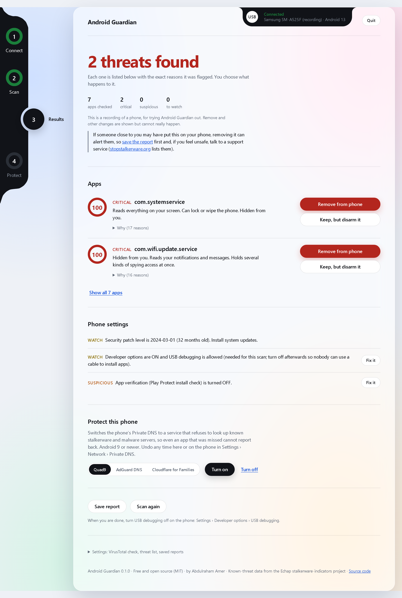
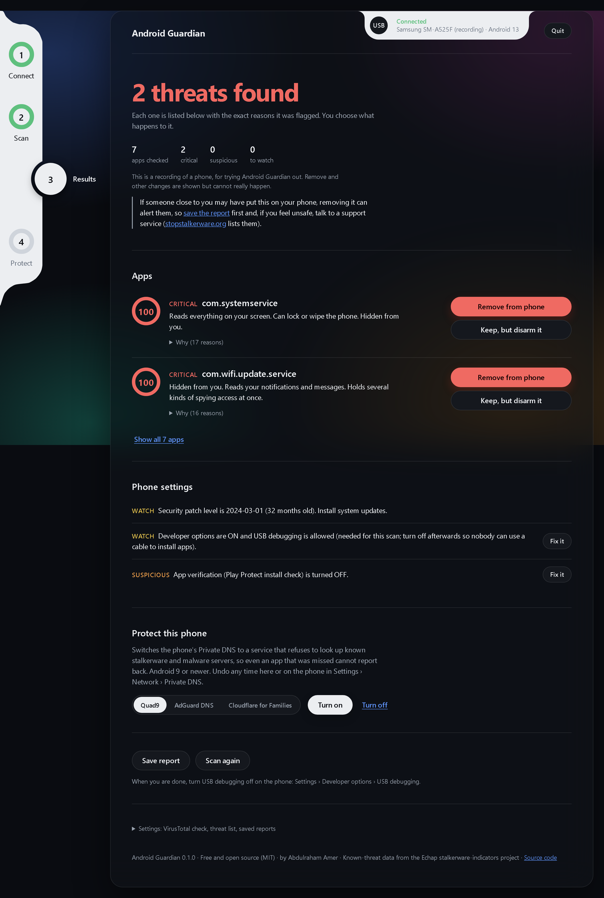
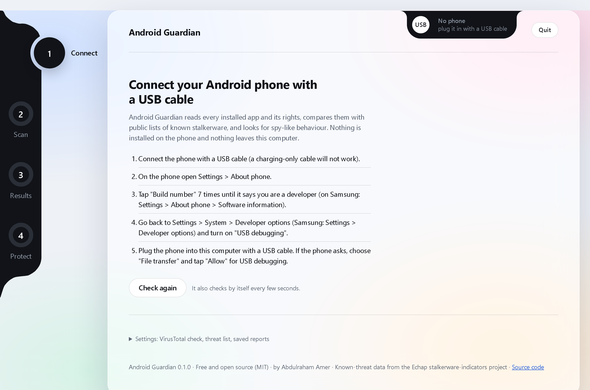
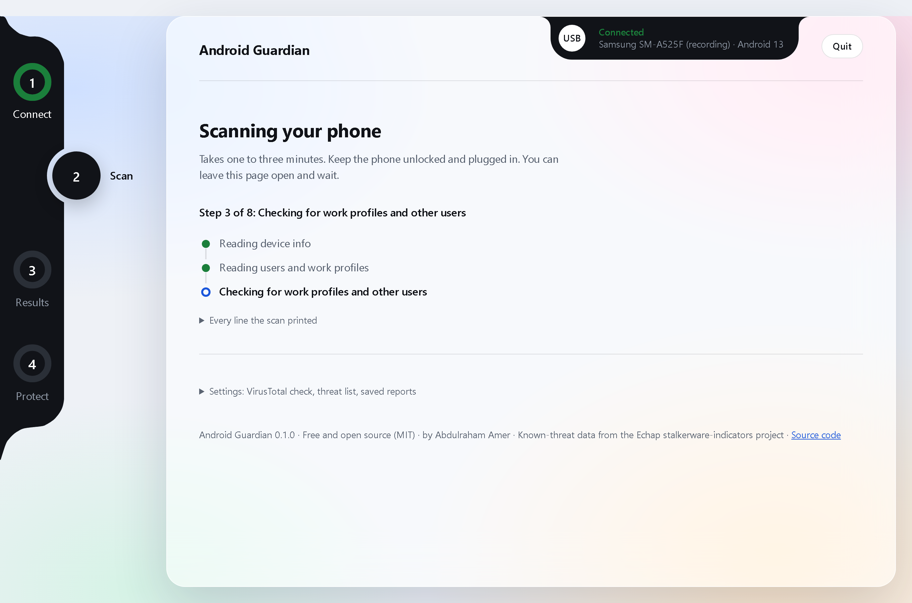

# Android Guardian

**Checks an Android phone for spyware, stalkerware and remote-control apps, and removes them.**
**It runs on a Windows PC. The phone connects with a USB cable.**
**Free and open source. Nothing is installed on the phone. Nothing about you is uploaded.**

Made by Abdulraham Amer. MIT licence.

> **If you think someone is watching your phone:** removing spyware can alert the person who installed it.
> If you could be in danger, talk to a support organisation first. There is a list at
> [stopstalkerware.org](https://stopstalkerware.org). Android Guardian saves a report you can keep as evidence.

Contents: [Install](#install) · [Prepare the phone](#prepare-the-phone) · [Use](#use) · [Uninstall](#uninstall) ·
[What it finds](#what-it-finds-and-what-it-does-not) · [Privacy](#privacy) · [SmartScreen](#windows-protected-your-pc-smartscreen) ·
[FAQ](#faq) · [Command line](#command-line) · [Build](#build-from-source) · [Licence](#licence)



<details><summary>More screens: dark mode, connecting, scanning</summary>





</details>

---

## Install

You need:

- A Windows 10 or Windows 11 PC (64-bit).
- The Android phone.
- A USB cable that carries data. The cable that came with the phone does. Some cheap cables only charge.

You do **not** need an administrator password. It installs only for your own Windows user.

### Way 1: one line (easiest)

1. Press the **Windows key**. Type `powershell`. Press **Enter**. A blue or black window opens.
2. Copy this line. Paste it into that window (right-click pastes). Press **Enter**.

   ```powershell
   irm https://raw.githubusercontent.com/AbdulrahmanAmer/android-guardian/main/installer/install.ps1 | iex
   ```

3. Wait about one minute. It downloads about 50 MB.
4. You see a green box that says **"Android Guardian … is installed."**
5. Android Guardian opens by itself. You also get a shortcut on the Desktop and in the Start Menu.

The installer checks that the download is exactly the published file (SHA-256). If it is not, it stops and installs nothing.

### Way 2: download and double-click

1. Open the [latest release](https://github.com/AbdulrahmanAmer/android-guardian/releases/latest).
2. Under **Assets**, click `AndroidGuardian-win64-v….zip` to download it.
3. Open your Downloads folder. **Right-click** the zip. Choose **Extract All…**, then **Extract**.
4. Open the extracted `AndroidGuardian` folder.
5. Double-click **Install.cmd**.
6. If Windows says "Windows protected your PC": click **More info**, then **Run anyway**.
   [Why this appears](#windows-protected-your-pc-smartscreen).

### Way 3: no install (portable)

Extract the zip anywhere, for example on a USB stick. Double-click **AndroidGuardian.exe**.
Settings and reports stay in that folder. To remove it, delete the folder.

### Updating

Run the same one line again, or Install.cmd from a newer zip. Your settings and saved reports are kept.

---

## Prepare the phone

Android hides the switch that lets a computer read the phone. It is called **USB debugging**. You turn it on in two steps:
first unlock **Developer options**, then switch on **USB debugging**. The app shows these steps too.

Find your phone below. Menu names can differ slightly between models. If you cannot find an item,
use the search box at the top of the phone's Settings and type the name (for example "Build number").

### Samsung (One UI)

1. **Settings → About phone → Software information.**
2. Tap **Build number** 7 times. Enter your PIN if asked. You see "Developer mode has been turned on".
3. Go back to the main **Settings** page. Scroll to the very bottom. Tap **Developer options**.
4. Turn on **USB debugging**. Tap **OK**.

### Google Pixel (and most other Android phones)

1. **Settings → About phone.**
2. Scroll down. Tap **Build number** 7 times. Enter your PIN if asked.
3. **Settings → System → Developer options.**
4. Turn on **USB debugging**. Tap **OK**.

### Xiaomi, Redmi, POCO (HyperOS or MIUI)

1. **Settings → About phone.**
2. Tap **OS version** (HyperOS) or **MIUI version** (MIUI) 7 times.
3. **Settings → Additional settings → Developer options.**
4. Turn on **USB debugging**.
5. Also turn on **USB debugging (Security settings)**. Without it the phone refuses changes from the computer.
   Xiaomi may ask you to put in a SIM card and sign in to a Mi account first. Scanning and removing apps work without it.

### OnePlus, Oppo, Realme (OxygenOS, ColorOS, realme UI)

1. **Settings → About device** (or About phone) **→ Version.**
2. Tap **Build number** 7 times.
3. **Settings → System settings** (OnePlus: **System**; older Oppo and Realme: **Additional settings**) **→ Developer options.**
4. Turn on **USB debugging**.
5. Oppo and Realme: if taking an app's rights away fails, also turn on **Disable permission monitoring** in Developer options.

### Huawei and Honor (EMUI, HarmonyOS, MagicOS)

1. **Settings → About phone.**
2. Tap **Build number** 7 times.
3. **Settings → System & updates → Developer options.**
4. Turn on **USB debugging**.
5. When you plug in, the phone may ask what the USB connection is for. Choose **Transfer files**.

### Then, for every phone

1. Plug the phone into the PC with the data cable.
2. Unlock the phone. It asks **"Allow USB debugging?"**
3. Tick **"Always allow from this computer"**. Tap **Allow**.

No question on the phone? See [Phone not detected](#phone-not-detected).

---

## Use

1. Open **Android Guardian** from the Desktop or the Start Menu.
   A black window opens and your web browser shows the app. Keep the black window open while you use it.
   Everything runs on your PC. The page is not on the internet.
2. Connect the phone (see above). The page checks again every few seconds. You can also click **Check again**.
3. Click **Scan this phone**. It takes one to three minutes. Keep the phone unlocked.
4. Read the result. Each app that looks wrong shows the exact reasons, in plain words.
5. For each flagged app, choose one:
   - **Remove from phone**: uninstalls it. Its special rights are taken away first, so it cannot block the removal.
     Built-in system apps cannot be uninstalled; they are switched off and wiped instead.
   - **Keep, but take its rights away**: the app stays, but loses microphone, camera, messages, call log,
     location and contacts, cannot run in the background, and loses its background internet.
6. Optional: under **Protect this phone**, **Turn on** switches the phone's Private DNS to a service that blocks
   known spyware servers (Quad9 by default). Android 9 and newer. **Turn off** undoes it, or on the phone:
   Settings → Network → Private DNS.
7. Your report is saved in the `reports` folder. **Open reports folder** shows it.
8. When you are done, click **Quit**, then on the phone turn **USB debugging** off again (Developer options).

---

## Uninstall

Pick any one. They all do the same thing.

- **Windows Settings**: Start → **Settings → Apps → Installed apps** (Windows 10: **Apps & features**) →
  **Android Guardian** → **⋯** → **Uninstall**.
- **The program folder**: open `%LOCALAPPDATA%\Programs\AndroidGuardian` (paste that into the File Explorer
  address bar) and double-click **Uninstall.cmd**.
- **One line in PowerShell**:

  ```powershell
  & "$env:LOCALAPPDATA\Programs\AndroidGuardian\uninstall.ps1"
  ```

  If PowerShell refuses to run scripts, use this instead:

  ```powershell
  powershell -NoProfile -ExecutionPolicy Bypass -File "$env:LOCALAPPDATA\Programs\AndroidGuardian\uninstall.ps1"
  ```

  Add `-Quiet` at the end to skip the question.

It asks whether to keep your saved reports. If you say yes (the default), they are moved to a folder called
**Android Guardian reports** on your Desktop. Then it removes the program folder, both shortcuts and the
Installed apps entry. Nothing else was ever written, so nothing else is left.

Nothing was installed on the phone, so there is nothing to remove there. Turn USB debugging off if you no longer need it.

---

## What it finds, and what it does not

**Known spyware**

- Package names, app file fingerprints (SHA-256) and signing certificates from the
  [Echap stalkerware-indicators](https://github.com/AssoEchap/stalkerware-indicators) list. This is the same data
  Amnesty International's Mobile Verification Toolkit uses. The list is refreshed every week.
- The default names of common remote-control trojan kits (AhMyth, L3MON, SpyNote, Metasploit and others).
- Optional: VirusTotal results for apps that did not come from an app store (needs a free VirusTotal key).

**Suspicious behaviour** (this catches renamed or home-made spyware that is on no list)

- Accessibility access, device administrator, notification access, usage access, battery-saver exemption.
- Microphone, camera, SMS, call log, location, contacts and file access, and risky combinations of them.
- No icon in the app drawer, a name that imitates a system app, not installed from an app store, installed recently.
- Real remote-control apps (TeamViewer, AnyDesk, AirDroid and similar) are pointed out, so you can confirm you installed them.

**The phone itself**

- Managed phone (device owner or work profile), root, unlocked bootloader, test firmware, old security patch,
  Play Protect turned off, a third-party keyboard or SMS app, Private DNS pointing at a bad server.

**What it cannot do**

- It cannot see spyware hidden inside the phone's firmware, or anything hidden by root on a modified phone.
  It tells you when the phone looks modified. A factory reset is the safe answer then.
- It cannot remove an app that is the phone's **device owner** (a fully managed phone). Only a factory reset removes it.
- It does not check iPhones, and it does not check the computer.
- A clean result is good news, not a guarantee.

---

## Privacy

- Your phone's data stays on your PC. App files and reports are never uploaded.
- The app talks to the internet for two things only:
  1. Once a week it downloads the public Echap threat list from GitHub. Nothing about you or your phone is sent.
  2. Only if you enter a VirusTotal key: it sends the SHA-256 fingerprints (not the files) of apps that did not come
     from an app store, to VirusTotal.
- The app's page runs on your own PC (`127.0.0.1`) and refuses connections from other computers.
- There is no tracking, no analytics and no account.
- The installer downloads only from this project's GitHub releases.

---

## "Windows protected your PC" (SmartScreen)

Windows shows this blue warning for new programs that are not yet known to Microsoft and are not code-signed.
It does not mean a virus was found.

- **The one-line install never shows it.** Files downloaded by PowerShell are not marked "from the internet",
  and the installer also removes that mark, so Windows treats the program like any other installed program.
- **With the zip**, click **More info → Run anyway** once.
- **Code signing is being applied for** through the [SignPath Foundation](https://signpath.org), which signs
  open-source projects for free. Until then, everything is here to read and build yourself, and every release
  lists SHA-256 fingerprints in `SHA256SUMS.txt`. See the [Code signing policy](docs/signing.md).
- The bundled `adb.exe` and `aapt2.exe` are already signed by Google.

**Antivirus.** Rarely, an antivirus removes `AndroidGuardian.exe` because it is new and unsigned and uses `adb`.
The installer notices and tells you. To restore it: Windows Security → Virus & threat protection →
Protection history → select the item → **Actions → Restore**, then run the installer again.

---

## FAQ

### Phone not detected

Try these in order. The app re-checks by itself.

1. Unlock the phone and look at its screen. Accept **"Allow USB debugging?"** if it is there.
2. Pull down the notification shade. Tap the **USB** notification. Choose **File transfer** (also called **Transfer files** or **MTP**).
3. Use a different cable. Many cables only charge (see the next question).
4. Use a USB port directly on the PC, not a hub, a dock or a front-panel port.
5. On the phone, **Developer options → Revoke USB debugging authorizations**. Unplug, plug in again, accept the question.
6. Close Android Guardian (Quit) and open it again.

### Is my cable "charging only"?

Set the phone to **File transfer** and open **File Explorer** on the PC. If the phone does not appear under
"This PC", the cable (or the port) does not carry data. Use the phone's original cable or one sold as a data cable.

### The phone shows up, but Windows says the driver is missing (older Windows 10)

Windows 10 version 1809 and newer, and Windows 11, already include what most phones need.
On older Windows 10, open **Device Manager**. If you see **ADB Interface** or your phone with a yellow warning:

- Samsung: install the **Samsung Android USB Driver** from [developer.samsung.com](https://developer.samsung.com/android-usb-driver).
- Google Pixel: install the [Google USB Driver](https://developer.android.com/studio/run/win-usb).
- Other brands: see Google's list of [phone maker drivers](https://developer.android.com/studio/run/oem-usb).

Then unplug and plug in the phone again.

### Xiaomi: "the phone refuses changes"

Turn on **USB debugging (Security settings)** in Developer options. See [Xiaomi](#xiaomi-redmi-poco-hyperos-or-miui).

### I removed an app, and after a restart it came back

Three possible reasons:

- **The phone is managed** (the app is the "device owner"). The report says so. Only a factory reset removes it.
- **Another app put it back.** Scan again and remove what is still flagged, then restart and scan once more.
- **It is part of the phone's software** from the maker or a shop. It was switched off and wiped; on some phones a
  system update switches it on again. Use **Keep, but take its rights away**, or factory-reset.

If something keeps coming back, back up your photos and contacts, do a factory reset, and change your Google
account password from another device. Do not restore a full phone backup made while the spyware was installed.

### The one-line install says "Could not create SSL/TLS secure channel"

Your Windows PowerShell is old. Paste this instead:

```powershell
[Net.ServicePointManager]::SecurityProtocol = 'Tls12'; irm https://raw.githubusercontent.com/AbdulrahmanAmer/android-guardian/main/installer/install.ps1 | iex
```

### The installer says "Could not reach GitHub"

Check that the PC is online. Or use [Way 2](#way-2-download-and-double-click): download the zip in a browser.

### The installer stopped with a number

| Number | Meaning | What to do |
|---|---|---|
| 2 | Wrong folder or option | Run Install.cmd from the extracted folder, not from inside the zip |
| 3 | Download failed | Check the internet connection, or use Way 2 |
| 4 | The download is not the published file | Nothing was installed. Try again later; report it if it repeats |
| 5 | Files are in use | Click Quit in Android Guardian, close windows showing its folder, run setup again |
| 6 | Files disappeared after copying | Antivirus. See [Antivirus](#windows-protected-your-pc-smartscreen) |
| 7 | Not 64-bit Windows | Android Guardian needs 64-bit Windows 10 or 11 |

### Can I install it somewhere else, or without shortcuts?

Run the installer with options (the one-liner itself cannot take options):

```powershell
& ([scriptblock]::Create((irm https://raw.githubusercontent.com/AbdulrahmanAmer/android-guardian/main/installer/install.ps1))) -Portable D:\AndroidGuardian
```

Options: `-Portable <folder>` (just unpack there), `-NoShortcuts`, `-NoLaunch`, `-Local <folder or zip>`,
`-Uninstall [-Quiet]`. Exit codes are listed at the top of [installer/install.ps1](installer/install.ps1).

### Does it work on a Mac or Linux?

The ready-made package is for Windows. From source it runs anywhere Node.js 20+ and `adb` run; see [CONTRIBUTING.md](CONTRIBUTING.md).

---

## Command line

The program also works without the browser page. Open PowerShell in the program folder, then:

```
.\AndroidGuardian.exe status                     is a phone connected and ready?
.\AndroidGuardian.exe scan [--json] [--out DIR]  scan and print the result
.\AndroidGuardian.exe remove <app>               remove an app, for example: remove com.example.spy
.\AndroidGuardian.exe block <app>                keep it, take its rights away
.\AndroidGuardian.exe protect-dns [quad9|adguard|cloudflare|off]
.\AndroidGuardian.exe --help                     all commands and options
```

Exit codes: `0` done / nothing found, `1` suspicious apps (or a step failed), `2` phone not ready,
`3` a threat was found, `4` error. `--help` prints the full, current list.

For a bug report, `scan --record <folder>` saves what the phone answered. Read it before you share it
(it contains app names and settings, not your messages or photos).

---

## Build from source

```
git clone https://github.com/AbdulrahmanAmer/android-guardian
cd android-guardian
node test/run.mjs        # tests, no phone needed
npm run demo             # the app with a recorded infected phone
node build.mjs           # the Windows package (needs Bun)
```

No npm dependencies. Details: [CONTRIBUTING.md](CONTRIBUTING.md). Security reports: [SECURITY.md](SECURITY.md).
Bundled third-party components and their licences: [THIRD_PARTY_NOTICES.md](THIRD_PARTY_NOTICES.md).

---

## Licence

MIT © 2026 Abdulraham Amer. See [LICENSE](LICENSE).

The known-threat data is © Echap and contributors, licensed CC BY-SA 4.0.
`adb` and `aapt2` are © The Android Open Source Project, Apache License 2.0.
The Bun runtime inside the program is MIT licensed, with its own bundled components.
Full details: [THIRD_PARTY_NOTICES.md](THIRD_PARTY_NOTICES.md).
